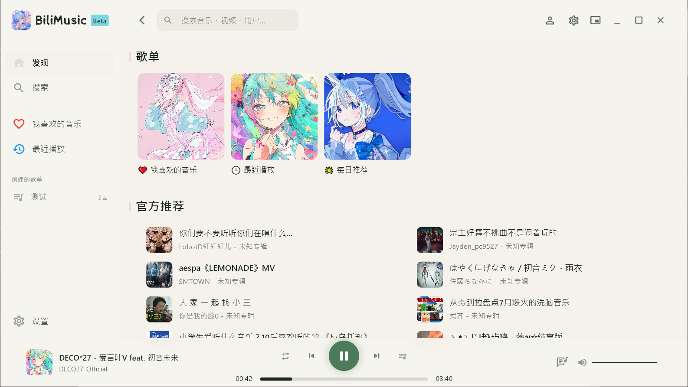
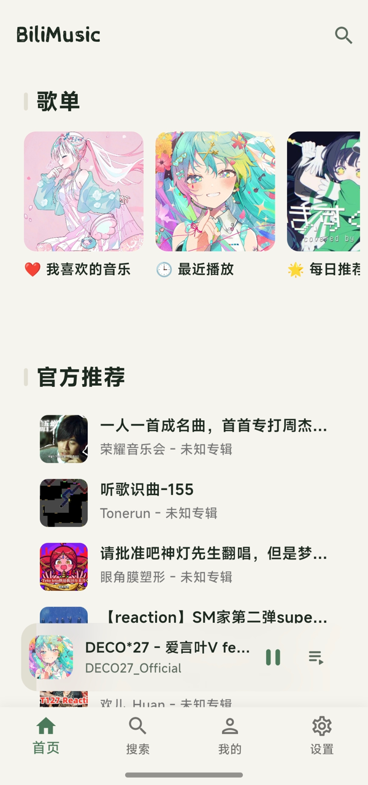
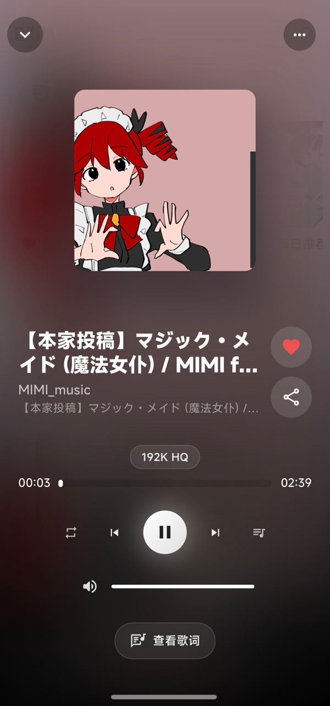
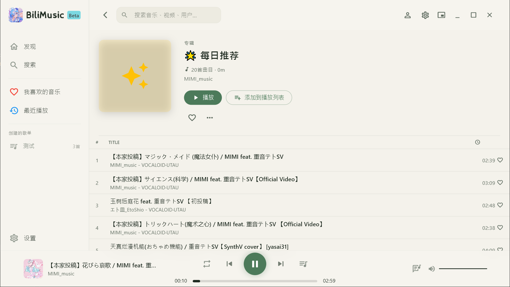
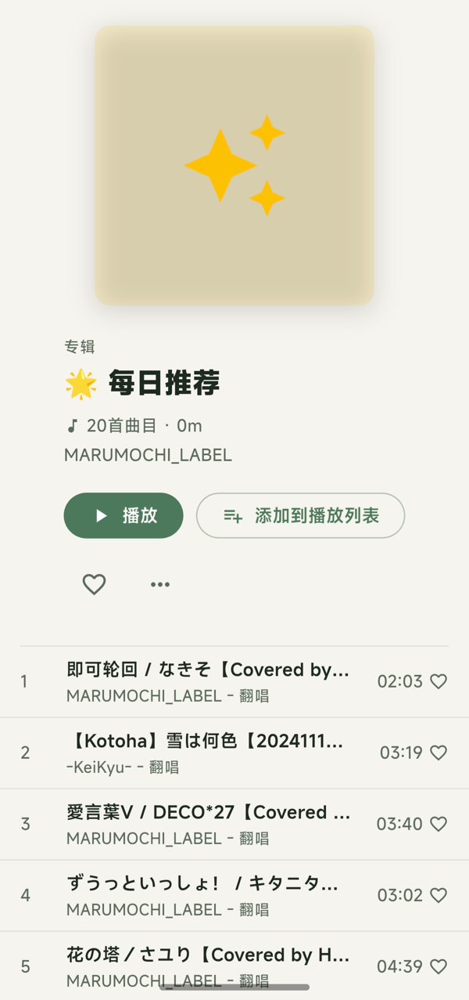

<div align="center">
  

  # BiliMusic

  <p><strong>刷 B 站的音乐，值得一个正经的播放器。</strong></p>
  <p>基于 Flutter 的 B 站音乐播放器 · 跨平台 · GUI/TUI/Vela/Extension · 漫游发现 · 局域网同步</p>

  <p>
    <a href="https://github.com/NaivG/bilimusic/releases"></a>
    <a href="https://github.com/NaivG/bilimusic/stargazers"></a>
    <a href="https://github.com/NaivG/bilimusic/network/members"></a>
    <a href="https://github.com/NaivG/bilimusic/issues"></a>
    <a href="https://github.com/NaivG/bilimusic/discussions"></a>
    <a href="LICENSE"></a>
    <a href="https://flutter.dev/"></a>
    <a href="https://riverpod.dev/"></a>
    <a href="https://github.com/RichardLitt/standard-readme"></a>
  </p>

  <a href="https://trendshift.io/repositories/319657?utm_source=trendshift-badge&amp;utm_medium=badge&amp;utm_campaign=badge-trendshift-319657" target="_blank" rel="noopener noreferrer"></a>
</div>


BiliMusic 是一个用 Flutter 写的 B 站音乐播放器，一套代码覆盖 Windows、Linux、Android 和 HarmonyOS，macOS 和 iOS 是实验性支持，另外还有小米 Vela 手表端和 Chrome 扩展。
它只做播放器该做的事：搜索、整理、连续播放、跨设备同步。

<div align="center">
  <sub>如果这个项目对你有帮助，欢迎 ⭐ Star 支持一下！</sub>
</div>

---

## 目录

- [安全](#安全)
- [背景](#背景)
- [平台支持](#平台支持)
- [安装](#安装)
  - [直接安装](#直接安装)
  - [从源码运行](#从源码运行)
  - [构建发布版本](#构建发布版本)
  - [终端客户端（TUI）](#终端客户端tui)
  - [小米 Vela 手表端](#小米-vela-手表端)
  - [Chrome Extension](#chrome-extension)
- [用法](#用法)
  - [常用入口](#常用入口)
  - [漫游模式](#漫游模式)
  - [设备同步](#设备同步)
- [核心特性](#核心特性)
  - [发现与推荐](#发现与推荐)
  - [播放体验](#播放体验)
  - [整理与同步](#整理与同步)
  - [TUI 客户端](#tui-客户端)
- [界面预览](#界面预览)
- [登录与数据](#登录与数据)
- [更新与版本](#更新与版本)
- [技术架构](#技术架构)
- [主要依赖](#主要依赖)
- [开发命令](#开发命令)
- [路线图](#路线图)
- [社区与讨论](#社区与讨论)
- [如何贡献](#如何贡献)
- [维护者](#维护者)
- [致谢](#致谢)
- [许可证](#许可证)
- [Star History](#star-history)

---

## 安全

> [!IMPORTANT]
> BiliMusic 仅供学习交流使用，不得用于**任何**商业用途。所有数据和文档都来自网络公开资源，本项目不做任何逆向、修改或破解。
>
> BiliMusic 只提供音频播放能力，不提供任何视听内容。音乐和视频的版权归原作者所有，请尊重版权、合理使用。

---

## 背景

主流 B 站客户端是完整的视频平台，对「只想听声音」这件事并不友好：后台播放受限，歌单能力弱，跨设备体验也割裂。BiliMusic 把 B 站当成音乐内容源，只围绕听歌来做。

> 作者本人也是重度听歌用户，开发时会在意使用体验，新功能上线前会反复打磨<s>（其实是听了半天）</s>，这块不用太担心。

---

## 平台支持

> [!IMPORTANT]
> 从 v2.0 起，BiliMusic 会迁到 AGP 9.0，Android SDK 版本跟着升到 14，装之前留意一下兼容性。

| 平台 | 状态 | 备注 |
| --- | --- | --- |
| **Windows** 10+ | ✅ 稳定 | 解压即用，`x64` 或 `arm64` 架构 |
| **Linux** | ✅ 稳定 | Ubuntu 20.04+ 或主流发行版，`x64` 或 `arm64` 架构；需要[安装依赖](#直接安装) |
| **Android** 12+ | ✅ 稳定 | 按设备架构选择 APK（`arm64-v8a` / `armeabi-v7a` / `x86_64`），或全平台 AAB |
| **macOS 12+, with Metal Support** | ⚠️ 实验性 | CI 产出 ad-hoc 签名的未公证 `.app`，也可从源码构建 |
| **iOS 15+** | ⚠️ 实验性 | CI 产出无签名 `.ipa`，也可从源码构建 |
| **Web** | ⏸️ 暂停支持 | **1.9.2 为支持 Web 的最新版本**，解压后部署到 Web 服务器，需配置 CORS |
| **Xiaomi Vela** | ✅ 稳定 | 小米、红米手表系列（API 2+），下载 `.rpk` 安装，详见[小米 Vela 手表端](#小米-vela-手表端) |
| **Chrome Extension** | ✅ 稳定 | 浏览器内播放，还没打包，需要手动安装，详见[Chrome Extension](#chrome-extension) |
| **HarmonyOS** 5.0+ | 🧪 即将推出 | 可从源码构建，详见 [ohos/README.md](ohos/README.md) |

应用内更新支持 Android、Windows、Linux；macOS 会跳转到 Releases 页面（见[更新与版本](#更新与版本)）。

---

## 安装

### 直接安装

前往 [Releases](https://github.com/NaivG/bilimusic/releases) 下载对应平台的最新版本，解压运行即可。

- Android / Windows / Linux：启动时自动检查更新。
- macOS：需手动重新下载。

Linux 如果看不到托盘请自行 tray_manager 依赖（一般桌面端运行时都能满足）：

```bash
sudo apt install libgtk-3-dev libx11-dev libxi-dev
```

> libmpv 不再需要预装：播放引擎 mpv_audio_kit 会在构建期自动下载 libmpv 并随产物打包。

### 从源码运行

环境要求：Flutter 3.x · Dart SDK ^3.13.0

```bash
git clone https://github.com/NaivG/bilimusic.git
cd bilimusic
flutter pub get
flutter run               # 默认设备
flutter run -d <device-id> # 指定设备
```

> 首次 `flutter pub get` 报 `git-lfs ... Authorization error`：上游 `permission_handler_ohos` 把示例目录里那个 10MB 的 `icudtl.dat` 放在 gitcode 的 Git LFS 上，匿名拉取会被拒。pub 只要源码树，需要跳过 smudge（PowerShell：`$env:GIT_LFS_SKIP_SMUDGE='1'; flutter pub get`）。

### 构建发布版本

```bash
flutter build windows
flutter build linux
flutter build apk
flutter build macos
flutter build ios
```

### 终端客户端（TUI）

仓库里附带一个实验性终端客户端，和 App 共用登录状态（目前基于 Windows 下的 libmpv）：

```bash
dart run bin/bilimusic_tui.dart            # 交互式 TUI
dart run bin/bilimusic_tui.dart --probe    # 网络与解码分层自检
dart run bin/bilimusic_tui.dart --smoke    # 无终端驱动完整循环
dart run bin/bilimusic_tui.dart --preview  # 静态设计预览（假数据，无网络无声）
```

### 小米 Vela 手表端

`vela/` 是给小米 Vela 手表写的 JS 快应用，和 Flutter 主项目并列，不共享代码也不共享包管理。它走 `npm`，不跑 `flutter pub`：

```bash
cd vela
npm install                       # 首次安装依赖（仅需一次）
npm run verify                    # 离线自检（纯 Node，无设备/模拟器）
npm run start                     # AIoT-IDE 调试启动（aiot server --watch）
npm run build                     # 构建 RPK（aiot build）
```

> 设计目标、适配机型、安装教程、目录结构，见 [`vela/README.md`](vela/README.md)。

### Chrome Extension

Chrome 扩展端（MV3），同样和主项目不共享代码与包管理，需要 **Chrome 116+**。

还没有打包上架，把仓库拉下来手动装：

1. 拉取远程 UI 资源：

   ```shell
   node extension/scripts/gen_daisyui_subset.mjs        # daisyUI 组件子集
   node extension/scripts/gen_fontawesome_subset.mjs    # FA 图标子集 + woff2
   ```

2. 打开 `chrome://extensions`
3. 右上角打开「开发者模式」
4. 「加载已解压的扩展程序」→ 选择本 `extension/` 目录

详见 [`extension/README.md`](extension/README.md)。

---

## 用法

典型路径：

```text
搜索内容 → 加入歌单 → 开始播放 → 匹配歌词与主题 → 漫游扩展 → 局域网同步
```

### 常用入口

| 入口 | 用途 |
| --- | --- |
| 首页 | 推荐、猜你喜欢、播放历史 |
| 搜索 | 通过关键词 / BV / AV 查找 B 站音乐内容 |
| 歌单 | 管理本地歌单与导入的收藏夹 |
| 个人中心 | 用户信息、收藏、历史、漫游、设备同步 |
| 设置 | 主题、外观、播放、音效与均衡器、音频输出、缓存等偏好 |

### 漫游模式

1. 在个人中心进入漫游模式。
2. 选择歌单或歌曲作为种子。
3. 选择「相似 / 平衡 / 探索」风格。
4. 队列接近末尾时自动发现并补充相关歌曲。

### 设备同步

在同一个局域网里打开设备同步，应用会用 mDNS 找设备，扫码或发配对请求建立信任，之后就能同步播放状态和队列，也能远程控制。

---

## 核心特性

### 发现与推荐

- 支持 `BV` 号、`AV` 号与关键词搜索。
- 首页推荐、猜你喜欢、播放历史。
- 基于 simhash + SnowNLP 的相关度排序与漫游补队列。
- 三种漫游风格：**相似 / 平衡 / 探索**。

### 播放体验

- 播放 / 暂停 / 上一首 / 下一首 / 进度跳转；定时关闭。
- 多 P 视频切换、顺序 / 随机 / 单曲循环。
- A/B 双播放器 + equal-power 曲线的交叉淡入淡出；打开「自动淡入淡出」后，淡入淡出时长和触发位置按曲目时长自动推导。
- 多档音质可选，DASH 音频流按选择取流，界面上显示实际生效的音质。
- 音效与均衡器（设置 → 音效与均衡器）：8 段均衡器，频点可自定义，另有压缩器、交叉回馈、立体声增强、回声与混响。内置听感预设和耳机校准预设（Harman Over-Ear 2018 / Harman In-Ear 2019 / AutoEq In-Ear），按目标响应曲线在锚点上采样算出增益。
- 音频输出（设置 → 音频输出）：切换输出设备、调音频延迟、硬件直通（独占模式）、强制 DAC 采样率。
- 后台播放、系统媒体通知、桌面托盘、Windows SMTC 与 Linux MPRIS 媒体键控制、音量持久化。
- 详情页与长按菜单支持一键打开 B 站原网页。
- 动态歌词：自动匹配、逐字点亮、辉光效果。
- 主题系统：Lucent / Nocturne / Verdant / Gruvbox / Nord / Solarized 六套主题，运行时切换，并按封面主色适配。
- 标题元数据过滤（实验性）：用 AST 解析标题结构，把【MV】【中字】这类视频平台元信息从 B 站标题里剥掉，Hi-Res、杜比这些音质标识留着。
- 离线缓存：歌曲下载到本地，断网也能播。

### 整理与同步

- 本地歌单：创建、编辑、删除、拖拽排序、滑动删除。
- 导入 B 站收藏夹，并跟踪同步状态。
- mDNS 局域网发现 + TCP 二维码配对 + 远程播放控制。
- 支持手表、折叠屏外屏与近方形 PiP 窗口布局。

### TUI 客户端

- 主页与搜索结果两页布局，支持关键词 / `BV` / `AV` 搜索、播放、暂停与切歌，键盘鼠标都能用。
- FFI 直驱 libmpv（复用 App 构建产物里的 libmpv），和 App 共享登录态与网络层。
- 带 `--probe` / `--smoke` / `--preview` 三个参数，分别做自检、无终端驱动和静态预览。

> [!NOTE]
> 我们不考虑做对接音乐平台的歌曲元数据匹配，介于视频平台的内容差距较大，相对来说性价比过低。

---

## 界面预览

> 默认使用 Verdant 主题展示。

<div align="center">
  
  
  <p><sub>首页 · 推荐与播放历史</sub></p>

  
  
  <p><sub>播放页 · 封面、歌词与播放控制</sub></p>

  
  
  <p><sub>歌单 · 本地歌单与 B 站收藏夹</sub></p>
</div>

---

## 登录与数据

部分 B 站功能要登录。移动端通过 [gt3_flutter_plugin](https://pub.dev/packages/gt3_flutter_plugin) 完成账号密码登录，桌面端用 B 站 App 扫码。数据管理里可以把设置、歌单、收藏、播放历史、播放队列、自定义标签、音效、口味画像和登录状态整份导出，换机后再导回去。

> **数据存储**：歌单、收藏和历史保存在本地 SQLite；设置使用 `shared_preferences`；网络资源与歌词进入本地缓存；歌曲可另存为离线缓存，断网可播。桌面端启动时会检测多份数据库副本，发现冲突时引导选择保留哪一份，落选副本改名归档、绝不删除。迁移或清理前请做好备份。

---

## 更新与版本

应用启动后会检查一次新版本，有更新就弹出更新日志和「立即更新」按钮。

| 环节 | 来源 | 说明 |
| --- | --- | --- |
| 检测 | 仓库 `assets/version.json` | 只比较 `major.minor.patch`，忽略 `+build` 号 |
| 更新日志 | `assets/version.json` 的 `changelog` | 应用内「设置 → 更新日志」读取随包内置的同一份数据 |
| 下载 | GitHub Releases API | 点击更新时实时取下载地址与 sha256 摘要 |

Android 走 `flutter_app_update` 下载 APK 再拉起系统安装页，13 及以上会先申请通知权限，用来显示下载进度。Windows 和 Linux 下载便携版 zip，校验 sha256 后原地替换文件并重启。macOS 不支持应用内更新，点击后跳到 Releases 页面手动下载。

---

## 技术架构

项目里有四个并列的客户端：Flutter 主端（`lib/`）、终端客户端（`bin/`）、小米 Vela 手表端（`vela/`）、Chrome 扩展（`extension/`）。主端和终端客户端共用同一套纯 Dart 的网络与存储层，OpenHarmony 宿主（`ohos/`）也复用 `lib/`；Vela 和扩展则各自独立，只跟主项目共用 B 站接口协议。

技术选型上，Flutter 一套代码覆盖桌面和移动端，Riverpod 管状态与依赖注入，音频解码交给 mpv_audio_kit（libmpv），局域网同步用 mDNS 发现加 TCP 配对。代码按 UI / 状态 / 编排 / 领域模型 / 基础设施分层，`lib/core/` 保持纯 Dart 以便 TUI 复用；长生命周期服务只在 `lib/app/app_providers.dart` 这一处组合根创建与释放，UI 只消费 Provider。

分层职责、一次播放请求的路径、完整目录结构、启动与退出顺序、网络与存储模型、平台差异与架构约束，见 [ARCHITECTURE.md](ARCHITECTURE.md)。

---

## 主要依赖

| 依赖 | 用途 |
| --- | --- |
| [Flutter](https://flutter.dev/) | 跨平台 UI 框架 |
| [Riverpod](https://riverpod.dev/) | 状态管理与依赖注入 |
| [mpv_audio_kit](https://pub.dev/packages/mpv_audio_kit) · [audio_service](https://pub.dev/packages/audio_service) | 音频播放（libmpv 引擎）+ 后台与系统媒体控制 |
| [audio_service_win](https://github.com/NaivG/audio_service_win) · [audio_service_mpris](https://pub.dev/packages/audio_service_mpris) | Windows SMTC + Linux MPRIS 媒体控制 |
| [tray_manager](https://pub.dev/packages/tray_manager) | 桌面系统托盘 |
| [http](https://pub.dev/packages/http) | 统一 HTTP 客户端 |
| [bonsoir](https://pub.dev/packages/bonsoir) | mDNS 局域网设备发现 |
| [sqflite](https://pub.dev/packages/sqflite)（含 ffi 实现） | 本地 SQLite 数据存储 |
| [flutter_lyric](https://pub.dev/packages/flutter_lyric) · [lyrics_now](https://github.com/NaivG/lyrics_now) | 歌词渲染与多平台歌词源检索 |
| [color_thief_dart](https://pub.dev/packages/color_thief_dart) | 封面主色提取 |
| [gt3_flutter_plugin](https://pub.dev/packages/gt3_flutter_plugin) | 登录极验验证码 |
| [window_manager](https://pub.dev/packages/window_manager) | 桌面窗口管理 |
| [flutter_app_update](https://pub.dev/packages/flutter_app_update) · [permission_handler](https://pub.dev/packages/permission_handler) | Android 应用内更新与通知权限检查 |
| [flutter_cache_manager](https://pub.dev/packages/flutter_cache_manager) | 缓存管理 |
| [shared_preferences](https://pub.dev/packages/shared_preferences) | 跨平台本地存储 |
| [dart_tui](https://pub.dev/packages/dart_tui) | 终端 UI 框架 |

---

## 开发命令

```bash
flutter pub get       # 安装依赖
flutter analyze       # 静态分析（CI 使用 dart analyze --no-fatal-warnings）
dart format .         # 提交前必须执行，避免 CI 产生格式化噪声提交
flutter test          # 运行测试
flutter run           # 调试运行
```

> 提交改动前，至少跑一遍 `flutter analyze` 和 `dart format .`，并在目标平台构建验证一次。

---

## 路线图

正在维护/新版本的计划与进度见 [BiliMusic 路线图](https://github.com/NaivG/bilimusic/discussions/29)。

---

## 社区与讨论

日常交流、提问、想法都欢迎来 [GitHub Discussions](https://github.com/NaivG/bilimusic/discussions)：

| 想做的事 | 去哪里 |
| --- | --- |
| 随便聊、展示使用场景 | [General](https://github.com/NaivG/bilimusic/discussions/categories/general) |
| 提出功能建议 | [Ideas](https://github.com/NaivG/bilimusic/discussions/categories/ideas) |
| 参与投票 | [Polls](https://github.com/NaivG/bilimusic/discussions/categories/polls) |
| 提问求助（支持采纳答案） | [Q&A](https://github.com/NaivG/bilimusic/discussions/categories/q-a) |
| 分享自建主题、脚本或玩法 | [Show and tell](https://github.com/NaivG/bilimusic/discussions/categories/show-and-tell) |
| 报可以复现的异常现象 | [Troubleshooting](https://github.com/NaivG/bilimusic/discussions/categories/troubleshooting) |
| 查看版本发布与项目公告 | [Announcements](https://github.com/NaivG/bilimusic/discussions/categories/announcements) |

> [!TIP]
> 已经能稳定复现、确认是缺陷的问题，请直接开 [Issue](https://github.com/NaivG/bilimusic/issues/new/choose)，Issue 模板会引导你补齐平台与版本。发帖前请先搜索，也不要在公开帖子里粘贴 Cookie、账号信息等敏感数据。

---

## 如何贡献

报问题走 [Issue](https://github.com/NaivG/bilimusic/issues)，讨论去 [Discussions](https://github.com/NaivG/bilimusic/discussions)（分类和用法见[社区与讨论](#社区与讨论)），代码改动直接提 Pull Request。提交前请尽量做到：

1. 说明复现环境、平台与具体步骤。
2. 保持改动聚焦，并遵循现有 Flutter / Dart 代码风格。
3. 执行 `flutter analyze` 和相关测试。
4. 不提交 Cookie、账号信息、构建产物或其他敏感数据。

> 完整的开发环境、分支模型、提交规范、测试要求与代码硬性规则，见 [`CONTRIBUTING.md`](CONTRIBUTING.md)。

---

## 维护者

<a href="https://github.com/NaivG/bilimusic/graphs/contributors">
  
</a>

---

## 致谢

- UI 设计灵感：Apple Music, 某云音乐, [ParticleMusic](https://github.com/AfalpHy/ParticleMusic)
- 多平台歌词获取：[lyrics_now](https://github.com/NaivG/lyrics_now)
- 歌词渲染：[coriander_player](https://github.com/Ferry-200/coriander_player), [flutter_lyric](https://pub.dev/packages/flutter_lyric)
- GitHub Actions：[FlutterHub](https://github.com/xmaihh/FlutterHub)
- README 规范：[standard-readme](https://github.com/RichardLitt/standard-readme)
- SnowNLP 文本处理：[SnowNLP](https://github.com/isnowfy/snownlp)

---

## 许可证

本项目采用 [GNU Affero General Public License v3.0](LICENSE) 许可证。

```text
Copyright (C) 2026 NaivG and contributors.

This program is free software: you can redistribute it and/or modify
it under the terms of the GNU Affero General Public License as published by
the Free Software Foundation, either version 3 of the License, or
(at your option) any later version.

This program is distributed in the hope that it will be useful,
but WITHOUT ANY WARRANTY; without even the implied warranty of
MERCHANTABILITY or FITNESS FOR A PARTICULAR PURPOSE.
```

> [!WARNING]
> 本项目的图标采用 [CC BY-NC 4.0](https://creativecommons.org/licenses/by-nc/4.0/) 协议。

---

## Star History

[](https://star-history.com/#NaivG/bilimusic&Date)
